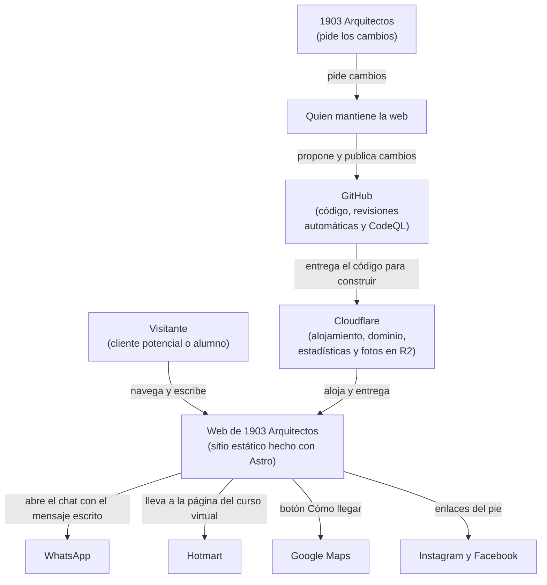
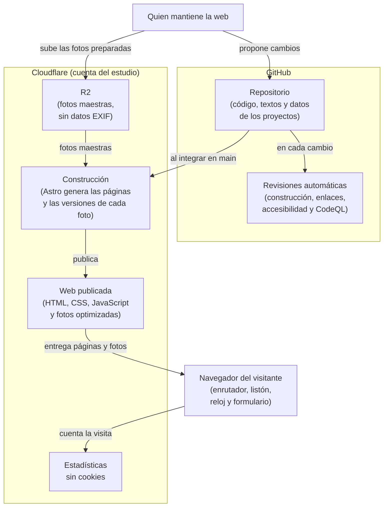

# Arquitectura de la web

Este documento explica **cómo está hecha la web de 1903 Arquitectos**: qué partes tiene, con qué servicios externos se conecta y cómo viaja un cambio desde el código hasta los visitantes. Está escrito para quien mantenga la web, aunque no haya estado en ninguna reunión.

El **por qué** de cada decisión está en las fichas de decisión ([ADR](adr/README.md)). Este documento cuenta el **qué** y el **cómo**, y enlaza a la ficha que corresponde.

Para describir la arquitectura usamos el **modelo C4**, que dibuja un sistema en niveles de detalle, como un mapa al que se le hace zoom: el nivel 1 muestra la web y lo que la rodea, y el nivel 2, sus partes grandes. La norma de referencia para describir arquitecturas es la ISO/IEC/IEEE 42010; aquí la aplicamos de forma ligera, proporcional al tamaño del proyecto.

## Resumen en una línea

La web es un **sitio estático** hecho con **Astro** (ADR 0001): al construirla se generan archivos HTML, CSS y unas pocas líneas de JavaScript, que **Cloudflare** entrega a los visitantes (ADR 0004). No tiene servidor propio, ni base de datos, ni panel de administración (ADR 0003).

## Quiénes se relacionan con la web y qué les importa

| Quién | Qué le importa |
|---|---|
| Visitante (cliente potencial) | Ver la obra del estudio, entender qué hace y escribirle sin complicaciones |
| Visitante (alumno) | Encontrar un curso e inscribirse |
| 1903 Arquitectos | Que la web le dé seriedad y le traiga clientes; que sus datos y los de sus clientes estén protegidos; pedir cambios y verlos publicados |
| Quien mantiene la web | Hacer cambios sin romper nada, entender rápido cómo está hecha y publicar con seguridad |

*Leyenda: "Quién" es cada persona o grupo que usa la web o depende de ella. "Qué le importa" resume lo que espera de la web. En la norma ISO/IEC/IEEE 42010 se los llama "interesados" y "preocupaciones".*

## Nivel 1 — La web y lo que la rodea

*Cómo leer el diagrama: cada recuadro es una persona o un sistema; cada flecha, una relación, con lo que pasa escrito encima. "Web de 1903 Arquitectos" es el sistema que se describe; los demás recuadros de sistemas son servicios externos que no controlamos.*

| Servicio externo | Para qué lo usa la web | Ficha |
|---|---|---|
| WhatsApp | Recibir las consultas del formulario y de los botones; inscripción a los cursos presenciales | ADR 0005 y 0006 |
| Hotmart | Vender los cursos virtuales; la web solo enlaza | ADR 0006 |
| Google Maps | Mostrar cómo llegar al estudio; la web solo enlaza, no inserta el mapa | ADR 0007 |
| Instagram y Facebook | Redes del estudio; solo enlaces | — |
| Cloudflare | Alojar y entregar la web, el dominio, las estadísticas sin cookies y el almacenamiento de fotos (R2) | ADR 0004, 0007 y 0011 |
| GitHub | Guardar el código con su historial, revisar cada cambio y buscar fallas de seguridad | ADR 0010 y 0014 |

*Leyenda: "Servicio externo" es un sistema de otra empresa con el que la web se relaciona. "Para qué lo usa la web" resume su función. "Ficha" es la ADR que explica la decisión. "Cookie" es un archivo pequeño que un sitio guarda en el navegador para reconocer al visitante.*

## Nivel 2 — Las partes de la web

*Cómo leer el diagrama: cada recuadro grande con título (GitHub, Cloudflare) agrupa las partes que viven en ese servicio; cada recuadro chico es una parte de la web; cada flecha, lo que pasa entre ellas. "main" es la rama principal del repositorio, la que siempre está lista para publicar. "Datos EXIF" son datos ocultos de las fotos, como la ubicación donde se tomaron.*

| Parte | Qué hace | Dónde vive | Ficha |
|---|---|---|---|
| Repositorio | Guarda el código, los textos de las páginas y un archivo de datos por proyecto, con todo su historial de cambios | GitHub, público, con lista blanca de archivos | ADR 0001 y 0010 |
| Revisiones automáticas | En cada cambio, comprueban que la web se construya, que no haya enlaces rotos ni errores de accesibilidad y que el código no tenga fallas de seguridad | GitHub | ADR 0013 y 0014 |
| R2 | Guarda las fotos maestras (2400 px, sin datos EXIF); las originales quedan en el Drive del estudio | Cloudflare, cuenta del estudio | ADR 0011 |
| Construcción | Astro toma el código y las fotos de R2, genera todas las páginas y cada foto en varios tamaños y formatos | Cloudflare | ADR 0001, 0004 y 0011 |
| Web publicada | Los archivos listos que reciben los visitantes, desde servidores cercanos a cada uno | Cloudflare | ADR 0004 |
| Estadísticas | Cuentan las visitas sin cookies y sin identificar a nadie | Cloudflare | ADR 0007 |
| Navegador del visitante | Muestra las páginas y corre el poco JavaScript de la web: el enrutador, que anima el cambio de página; el listón; el reloj de la barra superior, y el formulario, que arma el mensaje de WhatsApp | El dispositivo de cada visitante | ADR 0005, 0009 y 0012 |

*Leyenda: "Parte" es cada pieza grande de la web. "Qué hace" resume su función. "Dónde vive" es el servicio que la aloja. "Ficha" es la ADR que explica la decisión. "Enrutador" es el programa de Astro que maneja el cambio entre páginas.*

## Cómo viaja un cambio hasta los visitantes

1. El estudio pide un cambio a quien mantiene la web (ADR 0003).
2. Si hay fotos nuevas, se preparan con el script del repositorio (reducidas y sin datos EXIF) y se suben a R2 (ADR 0011).
3. El cambio se hace en una rama y se propone con un *pull request*; las correcciones chicas pueden ir directo a `main`. Un *pull request* es una propuesta de cambio que se revisa antes de integrarla.
4. Las revisiones automáticas comprueban el cambio. Si encuentran un error o una falla de seguridad grave, el cambio no se integra hasta corregirlo (ADR 0013 y 0014).
5. Cloudflare publica una **vista previa** del *pull request* en una dirección de prueba, para que el estudio la vea antes (ADR 0004).
6. Antes de publicar, se hace la revisión manual de accesibilidad (ADR 0013).
7. Al integrar el cambio en `main`, Cloudflare construye la web y la publica sola.

## Metas de calidad

Usamos los atributos de calidad de la norma **ISO/IEC 25010** como lista de lo que hay que cuidar, cada uno con una meta que se puede comprobar.

| Atributo | Meta | Cómo se comprueba |
|---|---|---|
| Rendimiento | En un celular, la foto principal de cada página se ve en menos de 2,5 segundos, y Lighthouse da 90 o más en rendimiento | Lighthouse, antes de cada publicación |
| Accesibilidad | WCAG 2.2 nivel AA en todas las páginas | Revisión automática en cada cambio y revisión manual antes de publicar (ADR 0013) |
| Seguridad | 0 alertas de gravedad alta o crítica | CodeQL y Dependabot (ADR 0010 y 0014) |
| Mantenibilidad | Agregar un proyecto sin tocar la plantilla: solo su archivo de datos y sus fotos | Al agregar cada proyecto nuevo |
| Compatibilidad | Funciona en las dos últimas versiones de Chrome, Edge, Safari y Firefox, en escritorio y en celular | Prueba manual antes de publicar |
| Fiabilidad | La web sigue en línea aunque falle una construcción: Cloudflare mantiene la última versión publicada | Por diseño (ADR 0004) |

*Leyenda: "Atributo" es la característica de calidad, según la norma ISO/IEC 25010. "Meta" es el resultado que se busca, de forma que se pueda decir si se cumple o no. "Cómo se comprueba" es la herramienta o el momento en que se verifica. "Lighthouse" es una herramienta gratuita de Google que mide la calidad de una página. "WCAG 2.2 nivel AA" es el nivel del estándar internacional de accesibilidad web que adopta la web.*

## Riesgos

| Riesgo | Efecto si pasa | Cómo se reduce |
|---|---|---|
| La web depende de una sola persona para cada cambio | Los cambios esperan si esa persona no está disponible | Manual de mantenimiento con el paso a paso de los cambios frecuentes y una sección de traspaso; *fork* del repositorio en la cuenta del estudio al terminar las prácticas (ADR 0003 y 0004) |
| Cloudflare cambia sus productos o su plan gratuito | Hay que reconfigurar la publicación o las fotos | Como la web es estática, se puede mudar a GitHub Pages o Netlify sin cambiar el código; las fotos pueden volver al repositorio (ADR 0004 y 0011) |
| R2 no está disponible al construir la web | No se puede publicar una versión nueva | La web ya publicada sigue en línea; se publica cuando R2 vuelva (ADR 0011) |
| Faltan datos o fotos del estudio cerca del 15/11/2026 | Páginas incompletas el día de la publicación | Lo que falta se muestra entre [corchetes] y nunca se inventa; las prioridades del mapa del sitio dicen qué puede esperar ([mapa del sitio](mapa-del-sitio.md)) |
| Un dato sensible se sube por error al repositorio público | Información del estudio o de sus clientes expuesta | Lista blanca de archivos, detección de secretos y fotos sin datos EXIF; procedimiento para limpiar el historial (ADR 0010 y 0011) |

*Leyenda: "Riesgo" es algo que podría salir mal. "Efecto si pasa" es su consecuencia. "Cómo se reduce" es lo que ya está previsto para evitarlo o para limitar su daño. "Fork" es una copia de un repositorio en otra cuenta de GitHub.*

## Nivel 3 — Componentes de Astro

[Pendiente: se agrega después de migrar los wireframes a Astro, cuando existan las carpetas y los componentes. Describirlo antes sería suponer una estructura que puede cambiar al construirla.]
