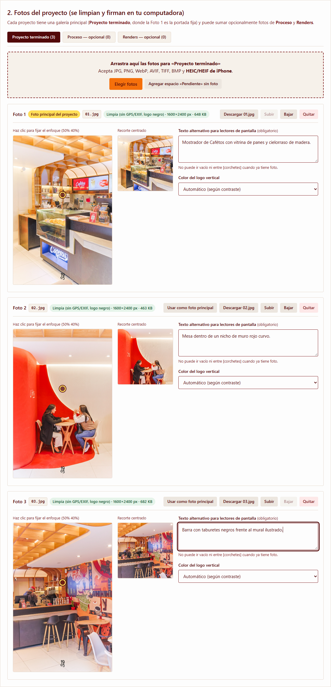
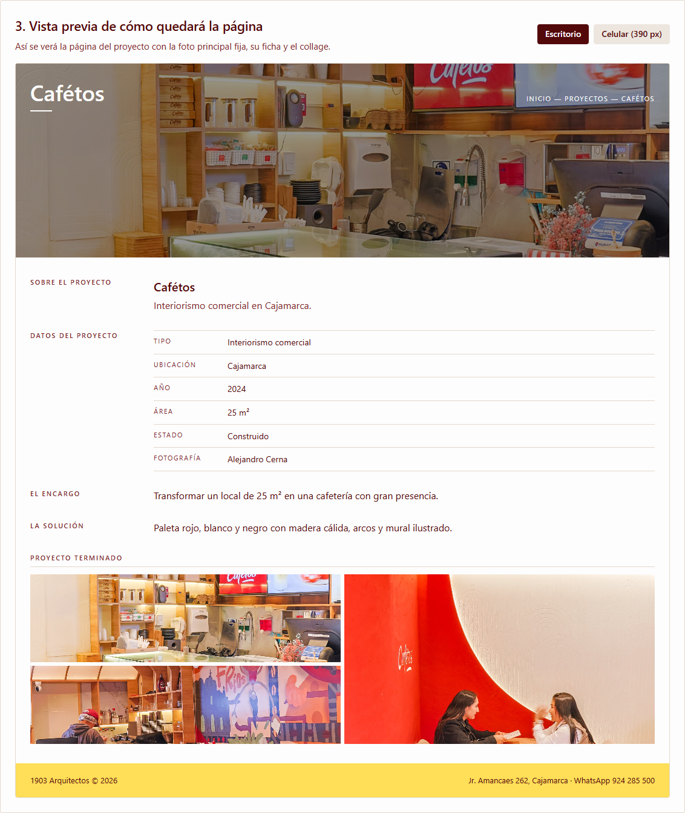
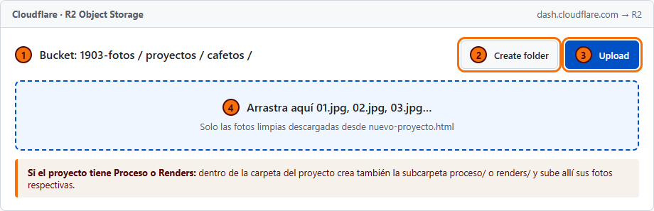
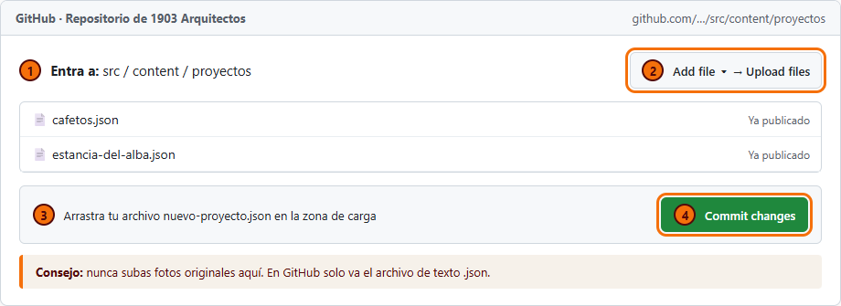
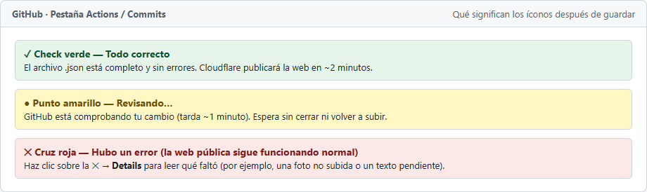

# Manual de mantenimiento — Web de 1903 Arquitectos

Esta guía explica, paso a paso y sin lenguaje técnico, cómo actualizar la web del estudio (**1903arq.com**) usando únicamente el navegador de internet (Chrome, Edge o Safari), sin instalar programas y sin riesgo de desordenar el diseño.

---

## 1. Cómo funciona la web en 1 minuto

La web está armada con **tres piezas separadas** para que sea rápida, segura y no tenga costos mensuales de servidor:

| Pieza | Qué es en palabras simples | Para qué la usará el estudio |
|---|---|---|
| **Asistente local (`nuevo-proyecto.html`)** | Un archivo que se abre con doble clic en la computadora (funciona incluso sin internet) | Preparar proyectos nuevos: achica las fotos, estampa el logo vertical abajo, borra los datos ocultos de ubicación (GPS) y arma la ficha de texto del proyecto |
| **Cloudflare R2** | El almacén privado de fotografías del estudio dentro de Cloudflare | Guardar las fotos limpias en alta calidad (2400 px) sin que queden expuestas en el repositorio público |
| **GitHub** | El archivador donde viven los textos y las fichas de cada proyecto | Subir la ficha de texto del proyecto (`.json`) o cambiar un dato de contacto o curso; al guardar, Cloudflare actualiza la web sola en ~2 minutos |

*Leyenda: "Pieza" es cada herramienta o servicio que interviene. "Qué es en palabras simples" describe su papel sin jerga de programación. "Para qué la usará el estudio" resume cuándo se abre. "GPS" es la ubicación exacta donde se tomó una foto y que las cámaras y celulares guardan oculta dentro del archivo.*

> **Tranquilidad total:** El diseño visual (colores, tipografía, listón, orden de las columnas y botones) vive aparte. Al agregar o editar proyectos nunca tocas el diseño, y si alguna vez falta un dato obligatorio, la revisión automática avisa y mantiene publicada la versión anterior sin romper la web.

---

## 2. Tarea 1: Cómo agregar un proyecto nuevo

### Paso A — Preparar las fotos y la ficha en tu computadora

1. Abre la carpeta `docs/mantenimiento/` del proyecto (o la carpeta compartida del estudio) y haz **doble clic en `nuevo-proyecto.html`**. Se abrirá en tu navegador de siempre.
2. **Completa la sección «1. Datos del proyecto»:**
   - Escribe el **Nombre del proyecto** (por ejemplo, `Cafétos`). El asistente creará solo el **nombre de archivo y carpeta** en minúsculas y sin tildes (`cafetos`), que será su dirección en la web (`/proyectos/cafetos/`).
   - Elige si es **Obra terminada** o **En desarrollo — solo render**.
   - Marca sus **categorías** (puedes elegir más de una si aplica, por ejemplo *Interiorismo comercial* y *Arquitectura*).
   - Si quieres que aparezca en la portada principal de **Inicio**, marca *«Proyecto destacado en la portada de Inicio»* y haz clic en la miniatura de la foto que quieres mostrar allí.
   - Completa los datos opcionales que tengas confirmados (**Área**, **Año**, **Crédito de fotografía**, **El encargo** y **La solución**). Lo que todavía no esté listo puedes dejarlo vacío.
3. **Carga las fotos en la sección «2. Fotos del proyecto»:**
   - Tienes tres pestañas: **Proyecto terminado** (obligatoria), **Proceso** (opcional, para fotos de obra en proceso) y **Renders** (opcional).
   - Arrastra las fotos desde tu carpeta (acepta JPG, PNG, WebP, AVIF, TIFF, BMP y **HEIC/HEIF de iPhone**).
   - El asistente hace cuatro cosas solo, dentro de tu computadora:
     1. Reduce la foto a un máximo de **2400 px** (calidad web sin pesar 20 MB).
     2. Estampa el **logo vertical `19 / 03 ARQ`** centrado en la parte inferior, eligiendo automáticamente **blanco o negro** según el contraste de esa zona de la foto (si en una foto prefieres cambiarlo o quitarlo, usa el selector *«Color del logo vertical»*).
     3. Borra todos los datos ocultos de cámara y ubicación (**EXIF / GPS**).
     4. Las renombra en orden (`01.jpg`, `02.jpg`, `03.jpg`…).
   - **Foto principal:** la **Foto 1 (`01.jpg`)** de *Proyecto terminado* es la que se verá fija arriba al abrir la página del proyecto. Si quieres cambiarla, pulsa **«Usar como foto principal»** en otra foto.
   - **Punto de enfoque:** haz clic sobre la parte importante de cada foto para que nunca quede cortada en los recuadros.
   - **Texto alternativo:** describe brevemente qué se ve en cada foto (por ejemplo: *«Mostrador de madera con vitrina de panes y cielorraso iluminado»*). Esto es obligatorio para que las personas con discapacidad visual puedan usar la web.

4. **Revisa la sección «3. Vista previa de cómo quedará la página»:**
   - Ahí ves en vivo la página completa tal como la verán los clientes, y puedes alternar entre **Escritorio** y **Celular (390 px)**.

5. **Descarga los archivos en la sección «4. Revisión y descarga»:**
   - Cuando el recuadro superior se ponga **verde** (*«Todo listo…»*), pulsa:
     - **«1. Descargar `<nombre>.json`»** (la ficha de datos).
     - **«2. Descargar fotos de Proyecto terminado»** (y, si cargaste *Proceso* o *Renders*, sus botones respectivos; guarda cada grupo en una subcarpeta distinta para que todas mantengan los nombres `01.jpg`, `02.jpg`…).

---

### Paso B — Subir las fotos limpias a Cloudflare R2

1. Entra a **dash.cloudflare.com** con la cuenta del estudio.
2. En el menú de la izquierda, abre **R2 Object Storage** y entra al almacén (*bucket*) de la web.
3. Entra a la carpeta del proyecto (o pulsa **Create folder** con el nombre exacto en minúsculas, por ejemplo `cafetos`).
4. Pulsa **Upload** y arrastra allí las fotos limpias (`01.jpg`, `02.jpg`…).
   - Si el proyecto tiene sección **Proceso** o **Renders**, crea dentro las subcarpetas `proceso` y `renders` y sube allí las fotos de cada una.

*(Nota de transición: si temporalmente el equipo todavía está guardando fotos dentro de GitHub antes de activar R2, las fotos limpias se suben a la carpeta `src/assets/proyectos/<nombre>/` siguiendo el mismo orden).*

---

### Paso C — Subir la ficha del proyecto (`.json`) a GitHub

1. Entra a **github.com** con la cuenta del estudio y abre el repositorio de la web.
2. Haz clic en las carpetas **`src`** → **`content`** → **`proyectos`**.
3. Arriba a la derecha, haz clic en **Add file** → **Upload files**.
4. Arrastra el archivo `<nombre>.json` que descargaste del asistente.
5. Baja y pulsa el botón verde **Commit changes**.

6. Espera ~1 minuto. En GitHub verás un punto amarillo mientras revisa que todo esté bien, y luego un **check verde (`✓`)**. En ~2 minutos, el proyecto nuevo ya estará publicado en **1903arq.com**.

---

## 3. Tarea 2: Cómo editar un proyecto o pasar un render a obra terminada

### Si solo quieres corregir un texto (encargo, solución, año, área)

1. En GitHub, entra a **`src` → `content` → `proyectos`** y haz clic en el archivo del proyecto (por ejemplo, `cafetos.json`).
2. Pulsa el ícono del **lápiz (Edit this file)** arriba a la derecha.
3. Cambia el texto respetando las comillas `"` al inicio y al final.
4. Pulsa **Commit changes**.

### Si quieres cambiar fotos o pasar un render a obra terminada

1. Abre `nuevo-proyecto.html`, carga los datos actualizados y las fotos nuevas (en la pestaña *Proyecto terminado*), cambia **Estado de la obra** a *Obra terminada*, y descarga el `<nombre>.json` y las fotos limpias.
2. Sube las fotos nuevas a la carpeta del proyecto en **Cloudflare R2** (reemplazando las anteriores si cambiaron de orden).
3. En **GitHub** (`src/content/proyectos/`), sube el nuevo `<nombre>.json` (al tener el mismo nombre, reemplaza al anterior).

---

## 4. Tarea 3: Cómo cambiar datos del estudio o cursos

| Qué quieres cambiar | Dónde está en GitHub | Qué editar |
|---|---|---|
| **WhatsApp, correo, dirección, horario o redes** | `src/config.ts` | Edita el texto entre comillas del dato que cambió y pulsa **Commit changes** |
| **Fechas, duración o enlace de Hotmart de un curso** | `src/i18n/textos.ts` | Busca la sección `cursos` (en español e inglés), cambia la fecha o agrega el enlace de Hotmart y pulsa **Commit changes** |
| **Preguntas frecuentes** | `src/i18n/textos.ts` | Busca la sección `servicios` (en español e inglés), localiza la pregunta o respuesta y actualízala entre comillas |

*Leyenda: "Qué quieres cambiar" es la información visible en la web. "Dónde está en GitHub" es la ruta del archivo dentro del repositorio. "Qué editar" indica qué parte modificar con el lápiz de GitHub.*

---

## 5. Qué hacer si sale algún error (guía rápida de solución)

| Qué viste o qué pasó | Por qué ocurrió | Cómo se soluciona paso a paso |
|---|---|---|
| **En el asistente sale `Falló verificación: segmento 0xE2` (o `0xE1`)** | El archivo de imagen traía un bloque oculto (como perfil de color o metadatos) que no se pudo retirar | Actualiza el archivo `nuevo-proyecto.html` a la última versión del repositorio; si el error persiste con una foto dañada, ábrela y guárdala de nuevo como JPG o PNG desde *Fotos* o *Vista previa* y vuelve a arrastrarla |
| **No abre una foto `.heic` de iPhone en Windows** | En Windows, los navegadores necesitan el archivo compañero `lib/heic2any.min.js` junto a `nuevo-proyecto.html` | Verifica que la carpeta `lib/` esté en la misma carpeta que `nuevo-proyecto.html`. Si copiaste el HTML suelto sin internet, abre la foto en la app *Fotos* de Windows → **Guardar como → JPG** y arrastra ese JPG |
| **El botón de descargar está bloqueado y dice que falta un texto alternativo o está `[pendiente]`** | Toda foto subida debe llevar su descripción real (sin corchetes `[ ]`) para cumplir accesibilidad | Escribe en la caja de *Texto alternativo* qué aparece en esa foto (1 oración corta) |
| **En GitHub aparece una cruz roja (`✕`) después de guardar** | Algo en la ficha `.json` o en las fotos no pasó la revisión automática. **La web publicada sigue funcionando normal.** | Haz clic en la **`✕` → Details** para leer el aviso: • *Si dice que falta una foto:* verifica que el nombre de la carpeta y los archivos (`01.jpg`, `02.jpg`…) coincidan con los del `.json`. • *Si dice `debe ser .jpg en minúsculas` o `segmento 0xE1` (`npm run fotos`):* alguien subió una foto directa sin pasarla por `nuevo-proyecto.html`; bórrala y súbela limpia. • *Si dice `JSON syntax error`:* editaste el `.json` a mano y faltó una coma o comilla; genera de nuevo el `.json` en `nuevo-proyecto.html` |
| **Las fotos descargadas salieron como `01 (1).jpg`, `02 (1).jpg`** | Tu carpeta de `Descargas` ya tenía archivos llamados `01.jpg` de otro proyecto | Borra o mueve los archivos viejos de `Descargas` antes de descargar un proyecto nuevo, o renómbralos quitando el ` (1)` antes de subirlos |
| **Subiste un proyecto por error y quieres deshacerlo** | Necesitas volver al estado anterior | En GitHub, entra al archivo que subiste → pulsa el menú `...` arriba a la derecha → **Delete file** → **Commit changes** |

*Leyenda: "Qué viste o qué pasó" describe el mensaje o problema en pantalla. "Por qué ocurrió" explica la causa. "Cómo se soluciona paso a paso" da la acción exacta para resolverlo. "JSON" es el archivo de datos de un proyecto; "EXIF / segmento 0xE1 / 0xE2" son marcas internas ocultas dentro de un archivo JPEG.*

---

## 6. Traspaso y propiedad de las cuentas

- **Repositorio del estudio (*fork*):** cuando finalice mi etapa de prácticas, el estudio crea una copia (*fork*) del repositorio en la cuenta de GitHub del estudio y conecta Cloudflare Pages a esa copia. Así la web queda 100 % bajo control del estudio sin depender de cuentas externas.
- **Cuenta de Cloudflare:** tanto el dominio (`1903arq.com`) como la publicación de la web y el almacén de fotos (**R2**) pertenecen a la cuenta de Cloudflare del estudio desde el inicio.
- **Copia de respaldo de las fotos originales:** las fotos originales sin recortar ni marca de agua (10–20 MB) permanecen siempre guardadas en la carpeta **"PAGINA WEB"** del Google Drive del estudio como archivo histórico.
